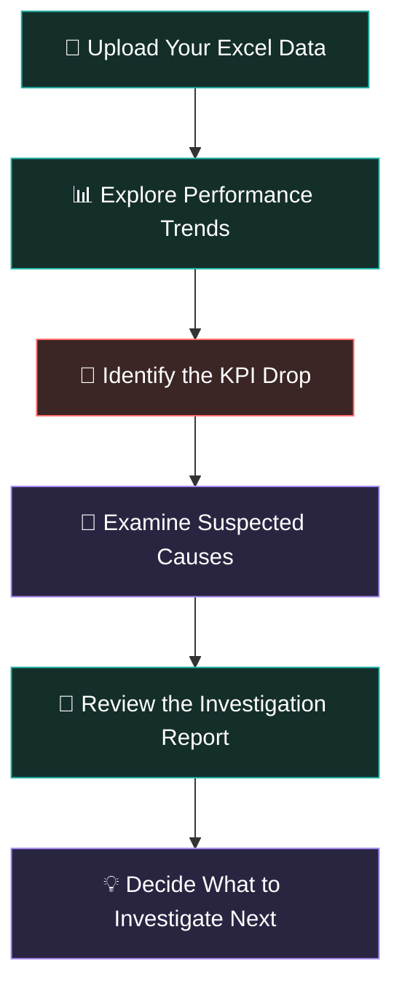

# 🕵️ WhyDrop — Every KPI Drop Has a Story

## 🌐 Try WhyDrop Live

<p align="center">
  <a href="[YOUR_LIVE_LINK_HERE](https://why-drop.vercel.app/)">
    <strong>🚀 Launch WhyDrop → </strong>
  </a>
</p>

<p align="center">
  Explore the application and see how WhyDrop turns business data into an investigation.
</p>

<p align="center">
  <strong>Your business numbers dropped. Let's find out why.</strong>
  <br />
  Turn confusing business data into a clear, guided investigation.
</p>

<p align="center">
  📊 Understand performance &nbsp;·&nbsp; 🔎 Investigate possible causes &nbsp;·&nbsp; 💡 Find your next lead
</p>

---

## 🎯 What is WhyDrop?

Imagine you're running a business and suddenly notice that sales have fallen by 25%.

**What happened? Why did it happen? Where should you look first?**

That's where WhyDrop comes in.

WhyDrop is a business investigation tool that helps you explore sudden drops in important business numbers, called **Key Performance Indicators (KPIs)**.

Instead of staring at spreadsheets and guessing what went wrong, you can upload your data, explore performance trends, and investigate possible explanations in one place.

Think of it as a **detective's office for business data.** 🕵️

## 🚨 The Problem

Picture this:

Your online store usually makes ₹1,00,000 in daily sales. Suddenly, sales fall to ₹70,000.

- 📉 Sales are down by 30%.
- 🤔 You don't know what caused the drop.
- 📑 Your data is scattered across spreadsheets.
- ⏳ Manually investigating everything takes time.

**WhyDrop helps you turn that mystery into a structured investigation.**

## 🔍 How It Works



### 🗂️ 1. Upload your data

Start by uploading an Excel file containing your business data.

No need to manually examine hundreds of rows before getting started.

### 📈 2. See what changed

Explore charts that help you understand how your numbers behaved over time.

Spot trends, compare values, and see where performance started to change.

### 🕵️ 3. Investigate the suspects

WhyDrop presents potential contributing factors to help you narrow down where to look.

Maybe sales dropped in a particular period. Maybe a specific category deserves closer attention.

The goal is to turn a broad question into smaller, more useful questions.

### 📋 4. Get your investigation report

Review the findings in a case-report-style interface.

You can also export data to CSV, copy a summary, or print the report for further review.

### 💡 5. Take the next step

Use the findings as a starting point for your business investigation.

WhyDrop helps you discover leads. **You still need to validate the evidence before concluding what actually caused the drop.**

---

## ✨ Features

| Feature | What it does |
|---|---|
| 📂 Excel Upload | Bring your business data into the investigation. |
| 📊 Interactive Charts | Explore performance trends visually. |
| 🚨 KPI Drop Analysis | Examine periods where performance declined. |
| 🔎 Suspect Lineup | Review potential contributing factors. |
| 📝 Case Report | View the investigation findings in one place. |
| 📥 CSV Export | Export data for further analysis. |
| 📋 Copy Summary | Copy an investigation summary for sharing. |
| 🖨️ Print Report | Print the findings for review. |
| 🌗 Theme Switching | Explore the interface in different themes. |
| 🎬 Interactive UI | Enjoy animated transitions and an investigation-inspired design. |

## 🎮 The WhyDrop Experience

Why should business analysis feel like staring at a boring spreadsheet?

WhyDrop uses an investigation-inspired interface to make exploring data more engaging.

- 🎯 **Follow the evidence:** Explore the timeline and potential causes.
- 🧩 **Connect the clues:** Understand what changed and where to look.
- 🗃️ **Build the case:** Review findings in a report-style layout.
- 💾 **Keep the results:** Export or share your findings.

The goal is simple: make data investigation feel more understandable, visual, and approachable.

---

## 👥 Who Is It For?

**📈 Business Owners**

Understand changes in sales, revenue, and other business metrics.

**📊 Business Analysts**

Explore performance trends and investigate unusual changes in data.

**🚀 Startups and Small Teams**

Get a more structured way to investigate performance problems.

**🎓 Students and Learners**

Explore how data analysis can help answer practical business questions.

You don't need to be a programmer to understand the purpose of WhyDrop.

---

## 🧪 A Simple Example

Suppose an online store records these sales figures:

| Month | Sales |
|---|---:|
| January | ₹1,00,000 |
| February | ₹1,10,000 |
| March | ₹1,05,000 |
| April | ₹75,000 |

April's sales are approximately **28.6% lower than March's**.

WhyDrop's purpose is to help investigate that decline.

Instead of immediately blaming marketing, pricing, or customer demand, you can examine the data, explore relevant patterns, and investigate possible explanations.

**A drop is the clue. The investigation is the next step.**

---

## 🛠️ Built With

The project combines tools that handle the visual experience and the data analysis.

| Technology | Role |
|---|---|
| ⚛️ React | Builds the interactive interface. |
| ⚡ Vite | Runs the frontend development server. |
| 🎨 CSS | Controls the design, layout, and visual effects. |
| 🎞️ Motion | Powers animations and transitions. |
| 📊 Recharts | Displays interactive charts. |
| 🐍 Python | Handles backend analysis. |
| 🌶️ Flask | Connects the frontend to the backend. |
| 📑 Excel / CSV | Supports data input and export workflows. |

---

## 🚀 Run WhyDrop Locally

Want to explore the project on your own computer?

You'll need **Node.js, Python, and pip** installed.

### 1. Get the project

Clone the repository and open its folder in your terminal.

```bash
git clone <YOUR_GITHUB_REPOSITORY_URL>
cd kpi_project
```

Replace the placeholder URL with your actual repository URL.

### 2. Start the backend

Open a terminal in the project root, where `app.py` is located.

```bash
pip install -r requirements.txt
python app.py
```

The backend should start at:

`http://127.0.0.1:5000`

### 3. Start the frontend

Open a second terminal.

```bash
cd frontend
npm install
npm run dev
```

Open the local address shown in your terminal, usually:

`http://localhost:5173`

Keep both terminals running while using the application.

<details>
<summary><strong>🧰 Troubleshooting</strong></summary>

**The browser shows a 404 error**

Check that `frontend/index.html` exists and is named correctly. The filename should not contain an extra space.

**The frontend opens, but analysis fails**

Check that the Flask backend is running on port `5000` and that the frontend is calling the correct API endpoint.

**Python reports a missing package**

Activate your intended Python environment and install the packages listed in `requirements.txt`.

**The charts or page appear blank**

Check the browser console and the terminal running Vite for errors.

</details>

---

## 🔮 The Bigger Picture

WhyDrop explores an important business question:

**How can we help people understand not just what changed, but where to look for an explanation?**

The vision is to make KPI investigation less intimidating and more systematic, even for people who don't work with data every day.

Rather than drowning users in numbers, WhyDrop aims to help them follow the evidence and ask better questions.

---

## ⚠️ Important Note

WhyDrop is an analytical investigation aid, not a guarantee of the true cause of a business problem.

The quality of its findings depends on the input data and the analysis performed. Suspected causes should be checked against reliable evidence before making business decisions.

---

<p align="center">
  <strong>📉 The numbers dropped. The investigation starts here.</strong>
  <br />
  <sub>Built with curiosity, data, and a detective's mindset. 🕵️</sub>
</p>
